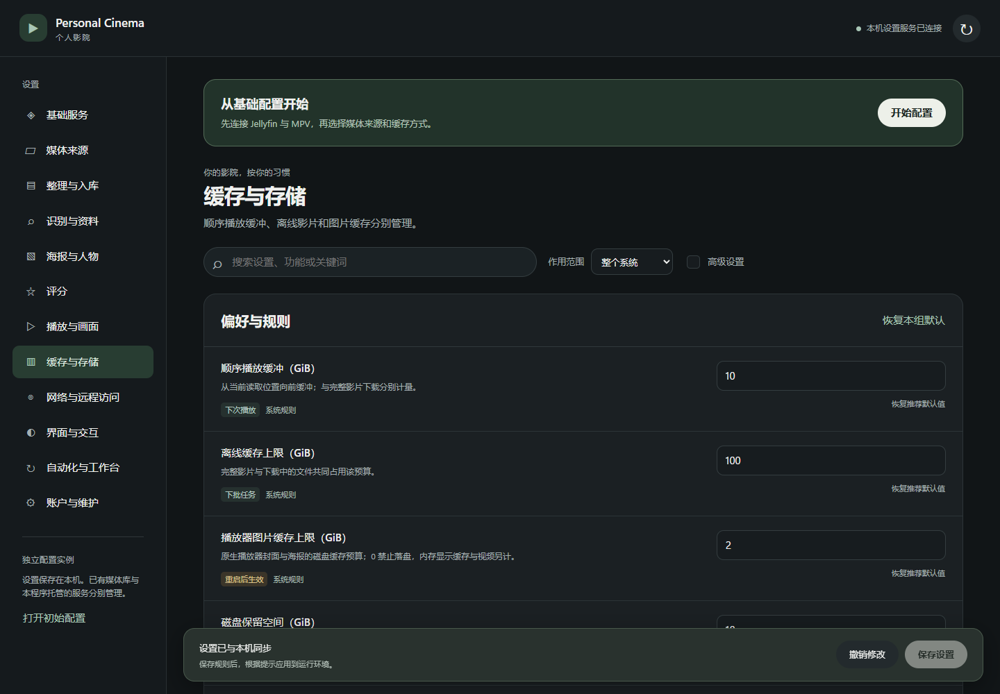

# Personal Cinema

面向 Windows 的个人影院：Jellyfin 管理媒体库，MPV 播放，本地设置页统一管理来源、资料、缓存与后台脚本。

当前是 `0.1.0a1` 开发预览。保留现有影院界面，新增独立安装与配置能力。
首次发布目标是 Windows x64；不宣称已经验证所有网盘账号、显卡或 HDR 屏幕。

## 开始使用

需要 Windows 10/11 x64、Python 3.11 或更新版本。把项目解压到可写目录，在 PowerShell 中运行：

```powershell
powershell -NoProfile -ExecutionPolicy Bypass -File .\scripts\Install.ps1
```

安装脚本会打开设置页。之后可以在 PowerShell 中运行 `scripts/Start.ps1`，或执行：

```powershell
.\.venv\Scripts\personal-cinema.exe
```

需要复现本次开发预览的依赖版本时，可在安装后执行：

```powershell
.\.venv\Scripts\python.exe -m pip install -c requirements-windows.lock .
```

此版本表来自 Windows x64、Python 3.13.3 的隔离环境，固定运行依赖及开发工具版本；它不包含程序本身、媒体组件或下载文件的哈希。其他 Python 版本仍需单独验证依赖兼容性。

首次向导按以下顺序完成配置：

1. 连接已有 Jellyfin，或指定本机托管程序并预览初始化计划。登录后读取媒体库。
2. 选择 MPV 与 ffprobe 程序。缺少组件时，可输入允许的官方下载 ZIP、版本和 SHA256，预览安装计划再执行。
3. 选择本地媒体目录；需要网盘时再启用 OpenList、授权并选择挂载目录。WebDAV 通过 OpenList 挂载接入。
4. 保存、应用运行配置，打开影院。目录、权限与可选评分密钥均由当前用户配置。

程序默认将实例数据存放在 `%LOCALAPPDATA%/PersonalCinema`，与源码目录分开。也可以指定：

```powershell
.\.venv\Scripts\personal-cinema.exe --data-dir "D:\CinemaData"
```

管理界面只监听本机。请通过启动入口打开带会话认证的设置页。不要直接公开管理端口。

## 设置与脚本

设置页包含基础服务、媒体来源、整理入库、识别资料、海报人物、评分、播放画面、缓存、网络、界面、自动化和维护。
每项标明作用范围与生效时机；未完成适配的选项会禁用并说明原因。



上图来自全新临时实例的实际浏览器截图，使用默认配置，不包含个人媒体来源、路径或账号。

后台扫描、身份匹配、中文演职人员、头像修复、独立季分、媒体探测、缓存及工作台均随项目提供。
它们通过统一运行入口使用当前实例配置；扫描按所选手动、启动时或定时模式触发，具体资料和评分仍受提供方、授权与作品覆盖率限制。
脚本归属与替代入口见 [脚本清单](docs/scripts-inventory.md)。

关键行为包括：

- 播放缓冲与完整影片缓存分别计量；当前播放优先，源文件变化使旧缓冲失效。
- 已人工确认的身份保留；主题曲与花絮归属主片；同一人物的职务合并显示。
- 海报检查真实尺寸；评分注明来源；独立季分不套用整剧分。
- 无法匹配可进入工作台手动指定；确认无照片的人员有终态，任务不会无限重试。
- 详情返回保留首页推荐和位置；统一主题、卡片、字号和减少动画设置。

托管操作只管理本实例创建的进程。已有服务通过连接使用，不会自动覆盖其配置。
云盘整理需要来源单独授权写入，默认只读和计划预览。
本机路径只能由本机 Jellyfin 使用；远程服务器需要自己能访问的目录，不能自动套用客户端路径。

## 凭据与迁移

账号令牌和播放器多用户资料使用 Windows DPAPI 加密，不写入发布包。
可分享的配置导出会移除凭据、私人路径与来源；新电脑需要重新授权。
私有备份仅包含本实例设置与加密凭据，不是全部服务数据、海报或影片的完整镜像。
它用于原 Windows 用户及机器环境下恢复，不能把 DPAPI 密文当作跨机器密码导出。
还原前必须停止本实例播放器和后台服务，程序会先创建安全备份。备份和维护清理不包含用户媒体原件。详见 [安全说明](SECURITY.md)。

## 当前限制

- 发布版只支持 Windows；没有 macOS、Linux 或手机原生客户端。Jellyfin 和现有客户端仍可分别使用，不包含 Kazumi 在线目录同步。
- 本地来源由本机 Jellyfin 直接读取，目前只读。云盘整理仅为已适配驱动开放；其他 OpenList 挂载可以读取，不自动获得改名、移动或删除权限。
- 优先网卡、校园网自动切换和 HypoMux 出口绑定尚未完成通用适配。可以选择直连、系统代理或 HTTP 代理；不能据此声称已绑定指定网络接口。
- 资料语言目前仅支持全局顺序；没有逐作品或逐季覆盖。评分和头像缺失不会靠生成数值或冒用照片补齐。
- 实例目录可在启动时选择；不提供跨盘搬运整套实例、媒体目录迁移或通用自动更新器。

已实现内容、验证证据和未实现事项见 [实施记录](docs/implementation-ledger.md)。

## 开发与验证

```powershell
.\.venv\Scripts\python.exe -m pip install -e ".[dev]"
$env:PYTHONPATH = "src;vendor"
.\.venv\Scripts\python.exe -m unittest discover -s tests -v
node --test tests/test_ui_logic.cjs
$env:CINEMA_BROWSER_TEST = "1"
.\.venv\Scripts\python.exe -m unittest discover -s tests -p test_ui_browser.py -v
.\.venv\Scripts\python.exe tools/release_check.py
.\.venv\Scripts\python.exe -m build
.\.venv\Scripts\python.exe tools/verify_installed.py
.\.venv\Scripts\python.exe tools/package_source.py
```

集成测试使用临时实例、模拟服务和本程序创建的短进程，不操作真实网盘。
发布前还应完成自己的服务登录、影片播放、HDR/SDR 与网盘驱动验收；自动测试不能代替这些环境相关验证。
发现问题请提供版本、复现步骤和脱敏诊断，避免提交整个数据目录。

## 许可与范围

这是包含自定义 Jellyfin MPV Shim 的衍生项目，不是 Jellyfin 官方发行版。
整体遵循 GPL-3.0-or-later，保留原作者及第三方许可，见 [第三方说明](THIRD_PARTY_NOTICES.md)。
不分发电影、个人海报库、账号 Cookie、私有网络配置或媒体服务器二进制。
Kazumi 保持独立软件；本发行版不包含已取消的在线番剧融合与新多版本功能。
